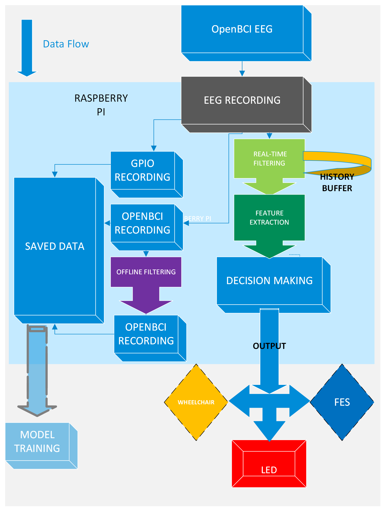

To explain the project in detail, you can read the PDF.  
The INSPiRE files are the main program and work together, while the inspiret files are independent programs that show the recordings.
The basic stacture of this project is 1.filtering 2.Feutere extraction 3.Deciosion out put(turning on a red led diode).
The basis of this project was the INSPiRE program from ΕΛΙΔΕΚ.
It can be used as a basis for future projects that will incorporate an AI model.
If you are interested in it, contact me.

Copyright (c) 2026 Dentsas Panagiotis
All Rights Reserved. This code may not be used, copied, modified, or distributed without explicit permission.

